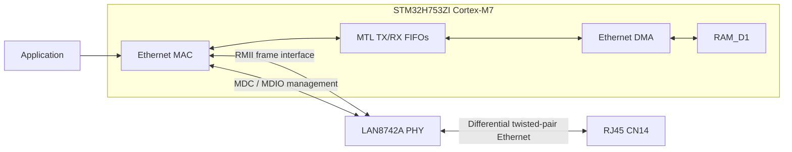
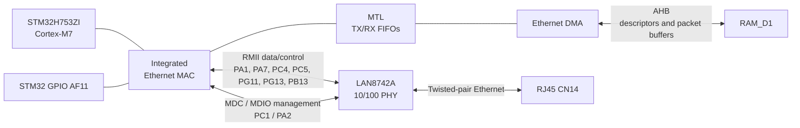

# Ethernet

## Overview

Ethernet provides packet-based communication between the STM32H753ZI and
devices on a local area network. The STM32H753 integrates the Ethernet MAC,
MTL queues, and Ethernet DMA. The MAC exchanges frames with the onboard
LAN8742A physical layer device over RMII. The PHY converts the RMII data and
control signals into electrical 10BASE-T or 100BASE-TX signals for the RJ45
connector.

This bare-metal driver currently provides:

- STM32H753 Ethernet MAC, MTL, and DMA initialization
- RMII GPIO and SYSCFG configuration
- LAN8742A Clause 22 MDIO/MDC communication
- PHY identification and link-status reporting
- DMA descriptor rings and receive-buffer management
- Store-and-forward TX/RX queue configuration

The implementation uses CMSIS register access and does not use STM32 HAL,
STM32 LL, an RTOS, or LwIP.

The initial target is:

- 10 Mbps or 100 Mbps Ethernet
- RMII between the STM32H753 and LAN8742A
- Clause 22 MDIO/MDC PHY management
- Store-and-forward MTL queues
- Ethernet DMA transfers between RAM_D1 and the MAC

## Basic architecture



The transmit path is:

```text
Application
    -> Ethernet TX packet buffer
    -> Ethernet DMA transmit descriptor
    -> MTL transmit FIFO
    -> Ethernet MAC
    -> RMII
    -> LAN8742A PHY
    -> RJ45 CN14
```

The receive path is:

```text
RJ45 CN14
    -> LAN8742A PHY
    -> RMII
    -> Ethernet MAC
    -> MTL receive FIFO
    -> Ethernet DMA
    -> RAM_D1 receive buffer
    -> Application
```

The CPU initializes descriptor rings and packet buffers. The Ethernet DMA
transfers frame data between RAM_D1 and the MAC, so the application does not
copy every Ethernet byte through the CPU data bus.

## NUCLEO-H753ZI board block diagram



## Hardware

| Component | Configuration |
|---|---|
| MCU Ethernet MAC | STM32H753 Ethernet peripheral |
| PHY | Microchip LAN8742A |
| Interface | RMII |
| Supported line speeds | 10 Mbps and 100 Mbps |
| PHY management | MDIO/MDC, IEEE 802.3 Clause 22 |
| LAN8742A PHY address | `0` |
| RMII reference clock | 50 MHz supplied by the LAN8742A |
| Board connector | RJ45 CN14 |

The board supplies a 25 MHz PHY crystal. The LAN8742A derives the 50 MHz
RMII reference clock used by the STM32H753.

RMII and PHY management serve different purposes:

- RMII carries frame data and data-valid/control signals.
- MDIO carries PHY register write/read data.
- MDC is the clock for MDIO transactions.
- The PHYID identifies the physical-layer device.

## RMII pin multiplexing

The Ethernet pins use STM32 GPIO alternate function `11` (AF11). The GPIO
mode, speed, pull, and output type must match the RMII and MDIO signal role.

| MCU pin | Board signal | Function | Direction |
|---|---|---|---|
| PA1 | `RMII_REF_CLK` | 50 MHz reference clock | PHY to STM32 |
| PA2 | `RMII_MDIO` | PHY register data | Bidirectional |
| PA7 | `RMII_CRS_DV` | Receive carrier/data valid | PHY to STM32 |
| PC1 | `RMII_MDC` | PHY management clock | STM32 to PHY |
| PC4 | `RMII_RXD0` | Receive data bit 0 | PHY to STM32 |
| PC5 | `RMII_RXD1` | Receive data bit 1 | PHY to STM32 |
| PG11 | `RMII_TX_EN` | Transmit data valid | STM32 to PHY |
| PG13 | `RMII_TXD0` | Transmit data bit 0 | STM32 to PHY |
| PB13 | `RMII_TXD1` | Transmit data bit 1 | STM32 to PHY |

PB13 also conflicts with an I2S/ST Zio signal. For Ethernet, JP6 must connect
PB13 to `RMII_TXD1`. The board revision solder bridges must enable the Ethernet
RMII signals, and SB72 must connect `RMII_MDIO`.

## PHY configuration

The PHY layer manages the LAN8742A independently of MAC frame descriptor
management. It uses MDIO for access and the RMII clock/data pins for the
LAN8742A-to-MAC data connection.

The current PHY integration is a read-only bring-up probe:

1. Enable the Ethernet clock domains and configure the RMII pins.
2. Wait until an MDIO transaction is no longer busy.
3. Read PHYID1 and PHYID2 from registers `0x02` and `0x03`.
4. Read BMSR at `0x01` twice; the link-status bit is latch-low.
5. `Ethernet_GetStatus()` refreshes BMSR and reads LAN8742A special status
   register `0x1F` for link, speed, and duplex reporting.

PHY reset, auto-negotiation control/wait, negotiated-mode application to the
MAC, and robust ongoing link management are intentionally deferred to the
future LAN8742A driver. The current MAC mode is a provisional 100 Mbps/full
duplex setting and is not derived from the PHY status.

The initial implementation uses these Clause 22 registers:

| Register | Address | Purpose |
|---|---:|---|
| BMCR | `0x00` | PHY reset, power-down, speed, duplex, and negotiation control |
| BMSR | `0x01` | PHY link status and supported capabilities |
| PHYID1 | `0x02` | High word of the PHY identifier |
| PHYID2 | `0x03` | Low word of the PHY identifier |
| LAN8742A special status | `0x1F` | Negotiated speed and duplex status |

A link is available only while BMSR bit 2 is set. LAN8742A special-status
register bit 4 indicates full-duplex operation, and bit 3 indicates
100 Mbps operation.

Future PHY-specific code should be separated from MAC implementation:

```text
Drivers/Ethernet/
├── ethernet_mac.c
├── ethernet_mac.h
├── lan8742.c
├── lan8742.h
└── README.md
```

`lan8742.c` will own PHY reset, auto-negotiation, link monitoring, and
LAN8742A vendor-register access. `ethernet_mac.c` will own MAC, MTL, DMA,
descriptor, frame, and interrupt operation. The current implementation keeps
the initial MDIO probe in `ethernet_mac.c` as a development skeleton.

## Programming model

RM0433 section 58.9 defines this Ethernet initialization sequence:

1. Initialize the DMA.
2. Initialize the MTL queues.
3. Initialize the MAC.
4. Enable normal receive and transmit operation.

`Ethernet_Init()` follows the RM0433 section 58.9 setup order and then performs
a read-only PHY probe:

1. Configure the RMII GPIO alternate functions and select RMII in SYSCFG.
2. Enable Ethernet MAC, transmit, and receive clock domains.
3. Apply the Ethernet DMA software reset.
4. Wait until `ETH_DMAMR.SWR` is cleared; stop initialization if the reset
   times out.
5. Create four 32-byte-aligned transmit descriptors.
6. Create four receive descriptors and 1536-byte receive buffers.
7. Program transmit and receive descriptor-ring addresses and ring lengths.
8. Configure DMA burst and channel parameters.
9. Configure MTL transmit and receive store-and-forward mode.
10. Configure MAC filtering and operating parameters.
11. Read the LAN8742A identity and initial link status over MDIO. PHY reset,
    auto-negotiation, and MAC mode adjustment are not implemented yet.
12. Start receive and transmit DMA.
13. Enable the MAC transmitter and receiver.

Descriptor and packet memory is placed in a dedicated `RAM_D1` linker section
to keep Ethernet DMA buffers out of DTCM. The section is 32-byte aligned for
DMA and Cortex-M7 cache requirements.

### 1. DMA initialization

- Stop transmit and receive DMA before descriptor configuration.
- Apply `ETH_DMAMR.SWR` and poll until the reset completes.
- Program descriptor-ring base addresses and tail pointers.
- Program ring lengths; the configured ring length is at least four entries.
- Configure receive descriptors with their buffer addresses and DMA ownership.
- Enable relevant normal and abnormal DMA interrupt sources.
- Start receive and transmit DMA after MAC/MTL setup.

### 2. MTL initialization

- Select store-and-forward transmit mode with `MTLTQOMR.TSF`.
- Select store-and-forward receive mode with `MTLRQOMR.RSF`.
- Configure the receive queue size for this Ethernet configuration.

### 3. MAC initialization

- Configure the MAC packet filter and MAC address registers.
- Configure the operating mode in `ETH_MACCR`.
- The skeleton uses a provisional 100 Mbps/full-duplex mode; it is not yet
  synchronized with negotiated PHY mode.
- Enable the MAC transmitter and receiver after DMA start.

### 4. Normal receive and transmit operation

- Poll receive-descriptor status or DMA interrupt status.
- A receive descriptor belongs to the DMA while its `OWN` bit is set.
- After a packet is received, reclaim the host-owned descriptor.
- Reinitialize the descriptor buffer and set `OWN` again.
- Write the receive tail pointer to notify DMA of the newly available descriptor.
- Disable transmit and receive operation before changing link speed or duplex.
- RX payload delivery to the application and TX frame submission are not
  implemented in the current skeleton.

## Driver files

The Ethernet directory contains all Ethernet and PHY-related files. The source
and header for a module stay together unless future maintenance requires
separate directories.

```text
Drivers/Ethernet/
├── ethernet_mac.c
├── ethernet_mac.h
├── lan8742.c          <- future PHY implementation
├── lan8742.h          <- future PHY API
└── README.md
```

### Ethernet MAC, MTL, and DMA

- [Ethernet MAC implementation](./ethernet_mac.c)
- [Ethernet public header](./ethernet_mac.h)

`ethernet_mac.c` currently covers RMII GPIO setup, Ethernet clock enable,
DMA reset and descriptors, MTL TX/RX queues, provisional MAC configuration,
MDIO transactions, a read-only PHY probe, and receive descriptor reclamation.

### LAN8742A PHY

The current PHY implementation is also in `ethernet_mac.c`. It provides
Clause 22 MDIO register access and LAN8742A status reporting.

Implemented PHY-related behavior:

- MDIO/MDC transaction support
- PHY ID and link/speed/duplex status reads

PHY reset, control, auto-negotiation, MAC mode coordination, and interrupt
handling remain future work. These responsibilities use PA2 for MDIO and PC1
for MDC.

## MAC driver APIs

```c
bool Ethernet_Init(void);
uint32_t Ethernet_GetRxPacketCount(void);
void Ethernet_GetStatus(Ethernet_Status *status);
```

| API | Subsystem | Purpose |
|---|---|---|
| `Ethernet_Init()` | MAC, MTL, DMA, PHY | Initializes the current skeleton and probes PHY identity/link |
| `Ethernet_GetStatus()` | PHY status | Reports link, speed, duplex, and PHY ID; does not configure the MAC |
| `Ethernet_GetRxPacketCount()` | RX DMA | Reclaims descriptors and counts packets; does not deliver payloads |

## PHY driver APIs

The current public MDIO APIs are:

```c
bool Ethernet_ReadPhy(uint16_t phy_reg, uint16_t *value);
bool Ethernet_WritePhy(uint16_t phy_reg, uint16_t value);
```

In a future PHY-specific implementation, these should be exposed through a
LAN8742A API such as:

```c
bool Lan8742_Init(void);
bool Lan8742_ReadRegister(uint16_t reg, uint16_t *value);
bool Lan8742_WriteRegister(uint16_t reg, uint16_t value);
bool Lan8742_GetLinkStatus(bool *link_up,
                           bool *full_duplex,
                           bool *speed_100m);
```

| API | Subsystem | Purpose |
|---|---|---|
| `Ethernet_ReadPhy()` | PHY/MDIO | Reads one Clause 22 PHY register |
| `Ethernet_WritePhy()` | PHY/MDIO | Writes one Clause 22 PHY register |
| `Ethernet_GetStatus()` | PHY status | Returns link, speed, duplex, and PHY ID |

## Board and silicon references

- [STM32H7 Reference Manual RM0433](../../Docs/rm0433-stm32h742-stm32h743-753-and-stm32h750-value-line-advanced-armbased-32bit-mcus-stmicroelectronics.pdf)
- [NUCLEO-H753ZI User Manual UM2407](../../Docs/um2407-stm32h7-nucleo144-boards-mb1364-stmicroelectronics.pdf)
- [STM32H753 Datasheet](../../Docs/DS_stm32h753zi.pdf)
- [LAN8742A Datasheet](../../Docs/DS_LAN8742_00001989A.pdf)
- [MB1364 C01 Schematic](../../Docs/mb1364-h753zi-c01-schematic.pdf)
- [MB1364 E01 Schematic](../../Docs/mb1364-h753zi-e01-schematic.pdf)
- [Reference-document index](../../Docs/README.md)

### Relevant RM0433 sections

| Section | Topic |
|---|---|
| 58.6.3 | RMII interface |
| 58.9.1 | DMA initialization |
| 58.9.2 | MTL initialization |
| 58.9.3 | MAC initialization |
| 58.9.4 | Normal transmit/receive operation |
| 58.9.8 | MII link-state transitions |
| 58.10 | Ethernet DMA descriptor structures |
| 58.11 | Ethernet MAC, MTL, and DMA registers |

The board-level Ethernet pins and solder bridges must be verified against
UM2407 and the correct MB1364 board schematic revision before hardware testing.
